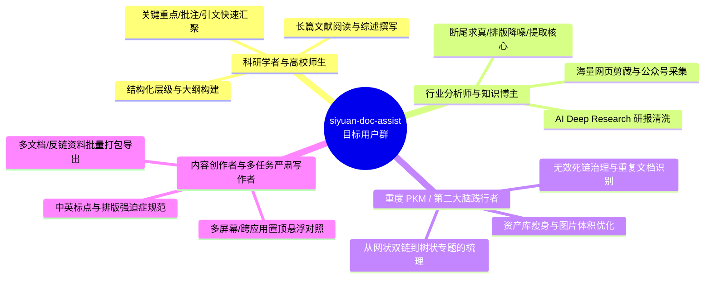
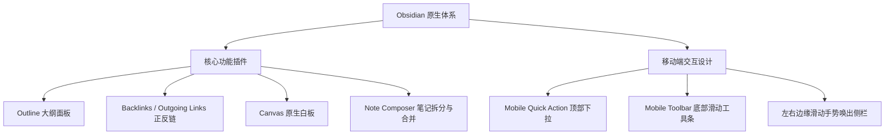
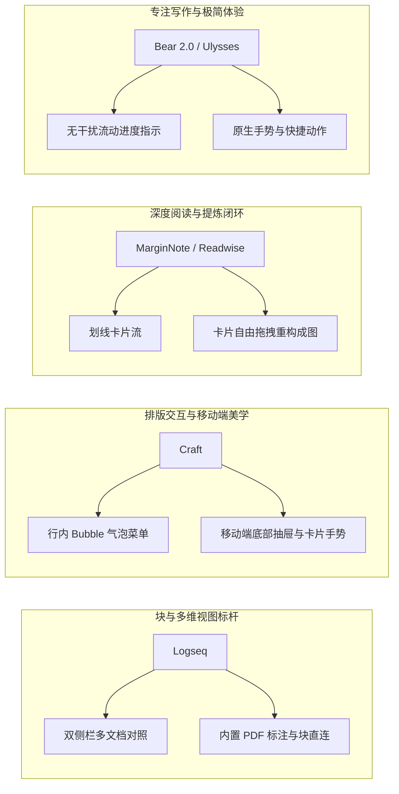
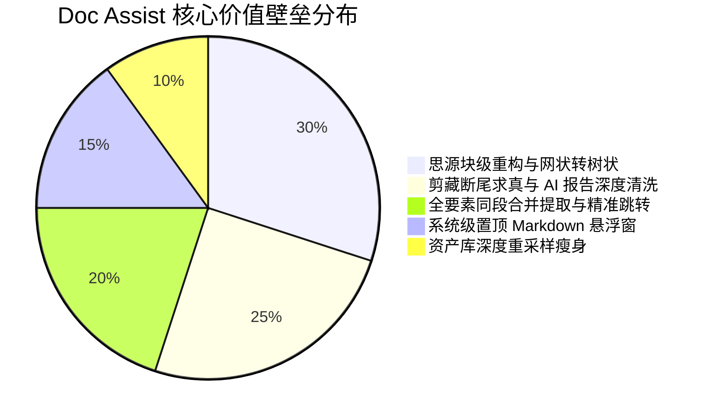
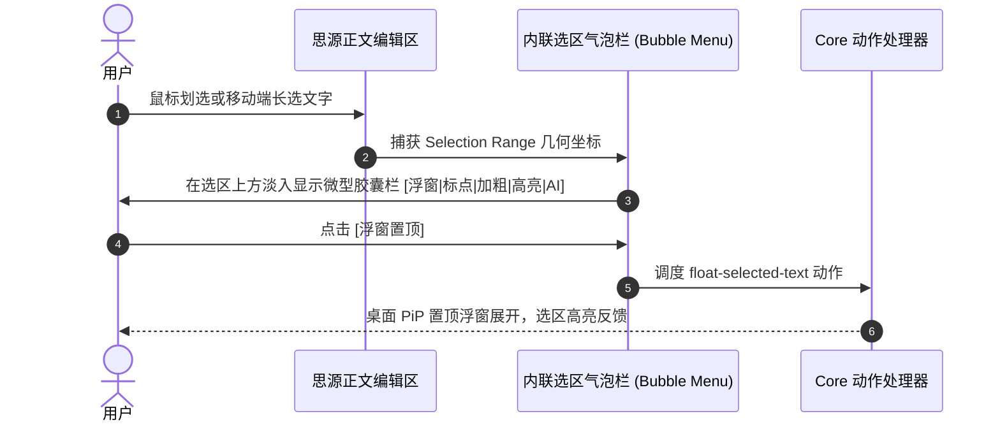
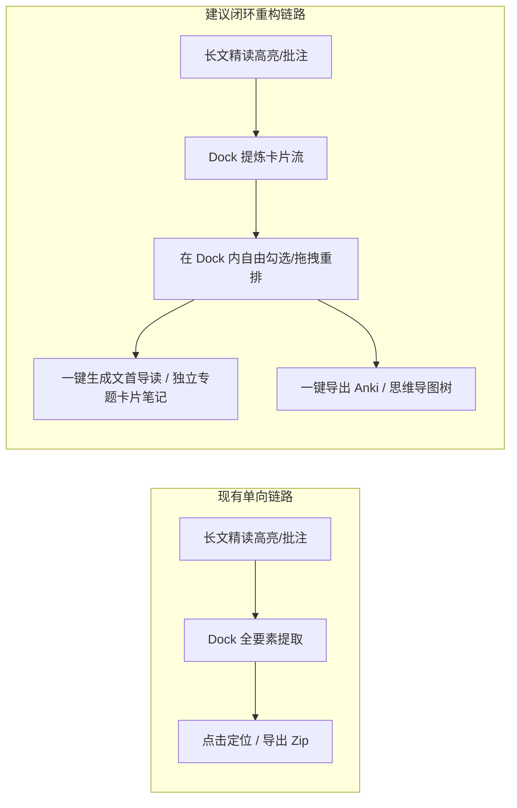
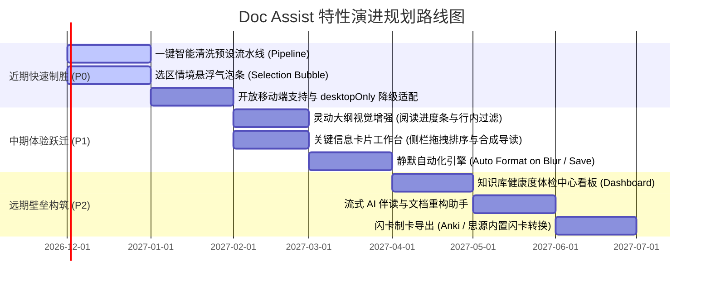

# 思源笔记文档助手 (Doc Assist) 产品竞争力分析与特性演化建议报告

> **报告版本**：v1.0  
> **编写日期**：2026-11-21  
> **基线版本**：siyuan-doc-assist v1.6.5（含最新灵动大纲与文档导航进展）  
> **目标读者**：插件核心作者、产品设计与架构开发者、社区核心协作者  

---

## 目录

1. [执行摘要与调研背景](#1-执行摘要与调研背景)
2. [本插件定位、使用场景与目标用户群深度画像](#2-本插件定位使用场景与目标用户群深度画像)
   - [2.1 产品核心定位](#21-产品核心定位)
   - [2.2 目标用户群深度画像](#22-目标用户群深度画像)
   - [2.3 核心业务场景与价值链路映射](#23-核心业务场景与价值链路映射)
3. [竞品生态针对性调研：Obsidian 官方与社区插件](#3-竞品生态针对性调研obsidian-官方与社区插件)
   - [3.1 Obsidian 官方原生能力矩阵](#31-obsidian-官方原生能力矩阵)
   - [3.2 Obsidian 社区对标插件深入分析](#32-obsidian-社区对标插件深入分析)
     - [3.2.1 大纲与视觉导航类：Quiet Outline & Hover Editor](#321-大纲与视觉导航类quiet-outline--hover-editor)
     - [3.2.2 排版清理与自动化规范类：Linter & Formatux](#322-排版清理与自动化规范类linter--formatux)
     - [3.2.3 重点提取与知识提炼类：Extract Highlights & Highlightr](#323-重点提取与知识提炼类extract-highlights--highlightr)
     - [3.2.4 笔记拆分与双链重构类：Note Refactor & Auto Note Mover](#324-笔记拆分与双链重构类note-refactor--auto-note-mover)
     - [3.2.5 媒体资产与离线识别类：Image Converter & Text Extractor](#325-媒体资产与离线识别类image-converter--text-extractor)
     - [3.2.6 AI 上下文与语义发现类：Smart Connections & Copilot](#326-ai-上下文与语义发现类smart-connections--copilot)
4. [跨生态与原生应用横向调研：PC 与移动端优秀实践](#4-跨生态与原生应用横向调研pc-与移动端优秀实践)
   - [4.1 Logseq（PC / 移动端）：块大纲天花板与双侧栏多视图对照](#41-logseqpc--移动端块大纲天花板与双侧栏多视图对照)
   - [4.2 Craft（Mac / iOS / iPadOS / Windows）：情境式气泡菜单与移动端排版美学](#42-craftmac--ios--ipados--windows情境式气泡菜单与移动端排版美学)
   - [4.3 MarginNote & Readwise Reader：批注提炼到知识卡片重组闭环](#43-marginnote--readwise-reader批注提炼到知识卡片重组闭环)
   - [4.4 Bear 2.0 & Ulysses：专注写作、流动进度面板与全端手势](#44-bear-20--ulysses专注写作流动进度面板与全端手势)
5. [产品竞争力对比矩阵与当前开发进展诊断](#5-产品竞争力对比矩阵与当前开发进展诊断)
   - [5.1 跨产品全维度功能与体验对比矩阵](#51-跨产品全维度功能与体验对比矩阵)
   - [5.2 当前项目（v1.6.5 + 灵动大纲）核心竞争力（Strengths）](#52-当前项目v165--灵动大纲核心竞争力strengths)
   - [5.3 当前项目核心短板与代差诊断（Gaps & Bottlenecks）](#53-当前项目核心短板与代差诊断gaps--bottlenecks)
   - [5.4 SWOT 综合态势分析](#54-swot-综合态势分析)
6. [后续补齐与增强优化的产品特性建议](#6-后续补齐与增强优化的产品特性建议)
   - [6.1 维度一：从“被动点击”到“自动化规则引擎”（借鉴 Linter / Macro）](#61-维度一从被动点击到自动化规则引擎借鉴-linter--macro)
   - [6.2 维度二：情境化交互与现代视觉升级（借鉴 Craft Bubble Menu / Hover Editor）](#62-维度二情境化交互与现代视觉升级借鉴-craft-bubble-menu--hover-editor)
   - [6.3 维度三：阅读提炼到卡片重构闭环（借鉴 MarginNote / Readwise）](#63-维度三阅读提炼到卡片重构闭环借鉴-marginnote--readwise)
   - [6.4 维度四：破局移动端体验断层（借鉴 Craft Mobile / Obsidian Ribbon）](#64-维度四破局移动端体验断层借鉴-craft-mobile--obsidian-ribbon)
   - [6.5 维度五：智能伴读与知识库健康中枢（借鉴 Smart Connections / Health Dashboard）](#65-维度五智能伴读与知识库健康中枢借鉴-smart-connections--health-dashboard)
7. [分期演进路线图与工程落地优先级（Roadmap P0 ~ P2）](#7-分期演进路线图与工程落地优先级roadmap-p0--p2)
8. [结语](#8-结语)

---

## 1. 执行摘要与调研背景

### 1.1 调研目的
随着个人知识管理（PKM）工具的高速演进，用户对于长篇资料研读、网页/微信剪藏加工、AI 生成研报（如 Deep Research、学术综述）清洗整理，以及网状双链结构化沉淀的需求日益迫切。

思源笔记（SiYuan Notes）凭借其严格的**底层 Block 树形架构**、**全量 SQLite 结构化索引**与**本地优先数据自主权**，在严肃知识管理领域积累了大量重度用户。**思源笔记文档助手（siyuan-doc-assist）**作为深度嵌入思源笔记编辑流程的综合性效率插件，现已迭代至 v1.6.5 版本，积累了 50+ 项涵盖“关键信息提取”、“长文排版清洗”、“正反链文档重组”、“多媒体瘦身”、“轻量 AI 处理”和“桌面置顶悬浮窗”的核心能力，并在近期推进了“灵动大纲（Dynamic Outline）”与“鼠标手势导航”。

为了明确插件在当前知识管理工具生态中的定位与壁垒，本报告系统性调研了 **Obsidian 官方原生功能及顶级社区插件生态**，横向对比了 **Logseq、Craft、MarginNote、Readwise Reader、Bear 2.0 等 PC 与移动端原生应用**，结合当前代码与架构现状，开展全维度竞争力诊断，并提出切中用户刚需的后续演化路径。

### 1.2 核心结论速览
- **独有优势与核心壁垒**：
  1. 深度适配思源独特的“块级（Block-level）DOM 与 SQL 引擎”，在跨文档结构调整（如反向链接文档一键批量移动为子文档）、大文件精准盘点、同级重复文档检测上，相比 Obsidian 等纯文件系统正则匹配具备更高的**确定性与执行效率**；
  2. 直击中文互联网与 AI 时代的强痛点（“断尾求真”一键消除公众号引流尾巴、Deep Research 报告一键消除多余学术引用标记与断裂列表）；
  3. 基于 Electron PiP 的“独立置顶悬浮窗（Floating Text Window）”，具备独立的 Markdown 渲染、搜索与字数统计，跨应用对照写作体验出色。
- **显著短板与竞争代差**：
  1. **移动端支持完全缺位**：配置清单限制为桌面端，移动端（手机/平板）高频剪藏与碎片阅读场景出现断层；
  2. **交互范式偏于传统被动**：过度依赖右键多级长菜单与侧栏 Dock 密集按钮，缺乏现代笔记工具的“选区行内浮动气泡（Bubble Menu）”与“轻量情境指示”；
  3. **自动化程度与规则定制性不足**：多为“单点手动触发”，缺乏类似 Obsidian Linter 的“保存/切换文档时后台自动流水线（Auto Lint on Save）”与宏组合（Macro）；
  4. **提炼与内化未成闭环**：关键信息提取聚合强大，但提取物仅支持“只读展示”与“简单导出”，缺少类似 MarginNote 式的卡片重组、自由排序与大纲沉淀。

---

## 2. 本插件定位、使用场景与目标用户群深度画像

### 2.1 产品核心定位
**思源笔记文档助手（Doc Assist）**的定位是：
> **思源笔记生态下的“深度阅读精炼、剪藏排版加工与结构化知识沉淀的瑞士军刀”。**

它不是对思源编辑器功能的替代，而是作为主编辑界面的“增强外骨骼”，在文档加工流水线中提供“输入清洗（Clean up）”、“结构化沉淀（Structure）”、“重点萃取（Extract）”与“多任务输出（Export/Display）”的端到端支撑。

### 2.2 目标用户群深度画像



1. **科研学者与高校师生（学术精读型）**：
   - *特征*：单篇文档长达数万字，充满专业名词、公式与引用。在阅读时做大量高亮、批注和双链。
   - *痛点*：划了重点后散落在长文中，难以提纲挈领；写论文开题或综述时，需要把分散的正反向引用文档归纳为树状大纲。
2. **行业分析师、投资经理与知识博主（剪藏与研报重度型）**：
   - *特征*：每日大量通过浏览器剪藏微信公众号、行业研报，或使用 ChatGPT / Claude / Gemini 生成 Deep Research 深度研究报告。
   - *痛点*：导入的文档充斥着“关注我们”、“阅读原文”等引流垃圾；AI 生成的 Markdown 带有密集的 `[1]`、`^^` 假引用标记、断裂缩进以及格式失真的列表；亟需一键清洗与规范化。
3. **重度 PKM 爱好者（知识库洁癖型）**：
   - *特征*：遵循 Zettelkasten 或 PARA 知识管理法，笔记数量在数千至数万篇以上，重视知识库的健康度与整洁度。
   - *痛点*：双链泛滥导致知识网混乱缺乏主干；长期积累导致死链（指向被删块的引用）、空段落、未使用的超大高清图片充斥 `assets/` 目录，同步与备份负担沉重。
4. **严肃写作者与跨屏多任务工作者（对照产出型）**：
   - *特征*：常常一边查阅技术规范/外文资料/视频教程，一边在代码编辑器或笔记软件中撰写。
   - *痛点*：单屏或小屏笔记本下，反复 `Alt + Tab` 切换打断思路；外文技术文档翻译繁琐；图片文字无法被全局搜索。

### 2.3 核心业务场景与价值链路映射

| 业务场景 | 输入资料特征 | 插件处理核心链路 | 最终输出价值 |
| :--- | :--- | :--- | :--- |
| **场景一：长文研读与重点提炼** | 篇幅极长、标记繁多的精读笔记 | 侧栏自动提取 H1~H6、加粗、颜色高亮、备注、标签、双链并同段合并；点击平滑滚动定位 | 告别“划了重点就沉睡”，实现全文脉络统揽与快速复习 |
| **场景二：剪藏与 AI 研报清洗** | 网页微信剪藏、Deep Research 报告 | 断尾求真（光标后全删）、删文首废话、清除 AI 脚注符号、中英标点互转、合并断裂列表 | 数秒内将格式混乱的毛坯内容加工为排版精良的结构化正文 |
| **场景三：知识网络向专题沉淀** | 散落全局的双链与反链节点 | 批量移动反链/正链为当前文档子文档；增量插入子文档/反链列表（自动去重）；标记死链 | 将二维网状混沌知识升维整理为清晰的树状知识专题库 |
| **场景四：多任务跨应用对照** | 提纲、参考段落、代码片段 | 一键投射到系统级置顶无边框半透明悬浮窗（Electron PiP），支持搜索与 Markdown 渲染 | 免切屏、免副屏，保持专注沉浸的心流体验 |
| **场景五：知识库瘦身与体检** | 历史堆积的大量图片、重复文档 | 批量 WebP/PNG 压缩、按当前显示尺寸重采样原图、Top 100 大文件盘点、同级重复文档识别 | 资产库体积缩减 60%~80%，显著降低云同步与备份开销 |
| **场景六：轻量 AI 与生态联动** | 外文文献、截图资料、长文大纲 | 逐段对比翻译、长图智能切片 OCR、AI 提炼优质标题、生成摘要并联动“无界画布” | 赋能单篇文档的深度理解与多模态扩展 |

---

## 3. 竞品生态针对性调研：Obsidian 官方与社区插件

作为双链笔记领域生态最繁荣的代表，Obsidian 拥有超过 2000+ 社区插件。其在文档大纲、排版规范化、重点提炼、工作流自动化等维度的演进方向，对思源文档助手具有极高参考价值。

### 3.1 Obsidian 官方原生能力矩阵



- **Outline（官方大纲插件）**：
  - 支持多层级标题折叠、折叠状态记忆；支持在大纲面板直接搜索过滤标题；
  - 缺点：仅支持标题（Headings），无法呈现文本内的加粗、高亮、备注等行内要素。
- **Backlinks / Outgoing Links（反链与出链）**：
  - 自动列出“提及的引用（Linked mentions）”与“未链接的提及（Unlinked mentions）”；
  - 支持在反链面板直接展开上下文并一键创建链接；
  - 缺点：反链仅用于展示，缺乏类似思源文档助手这种**直接调整底层物理目录树（移动为子文档）**的结构化重构能力。
- **Canvas（原生无限画布）**：
  - 官方内置的可视化白板，支持将任意笔记、段落、图片、网页卡片拖入画布自由连线。
- **移动端优秀交互机制**：
  - **Mobile Toolbar（底部滑动动作条）**：键盘上方常驻一排可高度自定义的快捷按钮（排版、加粗、插入模板、唤起命令），单手大拇指即可盲操；
  - **Mobile Quick Action（全局下拉呼出）**：类似手机系统的下拉手势，从顶部下滑直接触发预设的最常用动作（如全局搜索、新建今日日记等）。

---

### 3.2 Obsidian 社区对标插件深入分析

#### 3.2.1 大纲与视觉导航类：Quiet Outline & Hover Editor

##### ① Quiet Outline（静谧大纲）
- **核心功能机制**：
  - 被誉为 Obsidian 最强大纲增强插件。不仅支持 H1~H6 层级折叠和树状连线，还支持**非标题元素大纲**（支持在大纲中显示公式、代码块、高亮等特定标记）；
  - **阅读进度指示条**：在大纲条目左侧以细进度条显示当前视口在整篇文章中的滚动比例；
  - **实时搜索过滤**：侧栏顶部内置搜索框，输入关键字实时模糊匹配对应大纲节点；
  - **自动展开跟随**：当主编辑区滚动时，大纲自动平滑展开并高亮当前所在的层级章节，离开后自动收起其他无关分支（Keep Active Center）。
- **对本插件的启示**：
  - siyuan-doc-assist 正在开发 `dynamic-outline`（灵动大纲），已支持标题与关键内容联动。Quiet Outline 的“阅读进度跟随”和“大纲快速过滤搜索”是极佳的视觉与交互演进点。

##### ② Hover Editor（悬浮编辑器）
- **核心功能机制**：
  - 颠覆了传统“鼠标悬停仅展示只读预览”的逻辑，将悬停弹出的 Popover 转换为**完整可交互、可双向编辑、支持滚动、支持调整大小与置顶吸附的微型独立编辑器窗口**；
  - 可以在悬浮窗中嵌套悬浮窗，随时最小化为屏幕边缘的小药丸按钮。
- **对本插件的启示**：
  - siyuan-doc-assist 的 `Floating Window` 采用系统级置顶（Electron PiP），在“跨应用（如边看浏览器边记）”场景占优；
  - 但在“思源应用内快速查阅编辑另一篇参考笔记”场景下，应用内的 Hover 级浮窗比系统级 PiP 窗口更轻盈、唤醒更迅速。

---

#### 3.2.2 排版清理与自动化规范类：Linter & Formatux

##### ① Linter（格式化与排版自动化之王）
- **核心功能机制**：
  - Obsidian 社区下载量最高的排版插件之一，提供 **80+ 项极精细的排版规则**（中英文空格、全半角标点、空行数量、标题前空行、列表缩进格式、Frontmatter YAML 规范化、时间戳自动更新）；
  - **自动化触发机制（关键差异）**：不仅支持手动运行命令，最核心的是支持 **`Lint on Save`（保存时自动静默排版）** 和 **`Lint on File Switch`（切换文档时自动排版）**；
  - **全库批量执行**：一键对整个 Vault（或指定文件夹）批量应用所有排版规则；
  - **可视化细粒度配置**：每条规则均有独立的开关、参数输入框与前后效果示例。
- **对本插件的启示**：
  - siyuan-doc-assist 拥有非常扎实的文本清理核心（`src/core/markdown-cleanup-*.ts`），包含断尾求真、标点互转、空行消除等；
  - **致命短板在于“触发机制太被动”**：目前用户必须逐次打开命令面板或右键菜单手动点击执行；
  - 若能引入类似 Linter 的**“保存/失焦时静默自动清理”**与**“自定义清理规则预设流水线（一键执行指定清理组合）”**，用户体验将发生质的飞跃。

---

#### 3.2.3 重点提取与知识提炼类：Extract Highlights & Highlightr

##### ① Extract Highlights
- **核心功能机制**：
  - 遍历当前文档中所有使用 `==高亮==` 标记的文本，根据用户自定义的模板（Template），一键提取并生成为新的独立笔记，或者拷贝到剪贴板；
  - 提取的内容可自动附带：原文双链、块引用 ID、所在章节标题（H1/H2）、高亮先后顺序。
- **对本插件的启示**：
  - siyuan-doc-assist 的关键信息提取在**侧栏交互与同段合并**上远优于 Extract Highlights；
  - 但在**“提炼后的去向”**上：Doc Assist 目前支持导出 Zip、复制 Markdown 或生成无界画布。如果能支持**“一键把提取出的关键点归纳为当前文档文首的 Executive Summary，或生成为一篇带块双链的专题卡片笔记”**，提炼闭环将更完整。

---

#### 3.2.4 笔记拆分与双链重构类：Note Refactor & Auto Note Mover

##### ① Note Refactor
- **核心功能机制**：
  - 支持“按标题拆分（Split Note by Headings）”：将一篇万字长文根据 H1/H2 自动拆分为数十篇独立笔记，原笔记自动替换为这些新笔记的双链索引目录；
  - 支持“选中文本抽取为新笔记”：将选中的段落一键挪入新笔记，并在原位保留嵌入块（Embed）或双链引用。
- **对本插件的启示**：
  - siyuan-doc-assist 虽有 `split-doc-by-headings` 动作，但主要侧重思源底层的文档切割；
  - 可增强“抽取选区为子文档并在原处保留思源块引用（Block Reference）”的一键重构能力。

---

#### 3.2.5 媒体资产与离线识别类：Image Converter & Text Extractor

##### ① Image Converter
- **核心功能机制**：
  - 拦截粘贴行为，用户拖入或粘贴 PNG/JPG 时，直接在后台无感转换为现代化 WebP/AVIF 格式，并根据预设限制最大宽度（如不超过 1920px）；
  - 支持对历史附件库进行一键全量批量转换压缩。
- **对本插件的启示**：
  - Doc Assist 已支持 `convert-images-to-webp` 和 `resize-images-to-display`，能力极其强大（基于当前显示尺寸重采样更是杀手级功能）；
  - 建议后续增加“粘贴图片时自动按规则无感转换 WebP”的静默拦截选项，避免先存了原图再手动跑命令。

##### ② Text Extractor
- **核心功能机制**：
  - 基于本地离线 Tesseract.js 引擎，自动对笔记中的所有图片进行后台 OCR 扫描，将文字建立内部索引，使得搜索时可以直接搜出图片内的文字；右键图片可直接复制提取的文字。
- **对本插件的启示**：
  - Doc Assist 现有的 `recognize-doc-images` 走的是云端大模型 Vision OCR，优点是排版和识别准确率极高（尤其是长图自动切片），缺点是需要联网且依赖 API Key。
  - 可考虑未来提供轻量离线 OCR 选项，或完善 OCR 结果在本地全文搜索中的建索引机制。

---

#### 3.2.6 AI 上下文与语义发现类：Smart Connections & Copilot

##### ① Smart Connections
- **核心功能机制**：
  - 基于本地 Embedding 模型（或 OpenAI Embedding），自动对整库所有笔记和段落计算向量；
  - 当你在写某篇笔记时，侧栏实时列出**“全库语义最相关的前 10 篇笔记”**，帮助发现未打标签、未建立双链的潜在隐秘关联（Serendipity）；
  - 支持针对全库笔记进行语义 RAG 智能问答。
- **对本插件的启示**：
  - Doc Assist 目前的 AI 动作是“单点功能”（AI 起标题、AI 逐段翻译、AI 摘要、AI 标记口水话）；
  - 缺少针对文档上下文的多轮流动式伴读与智能追问。

---

## 4. 跨生态与原生应用横向调研：PC 与移动端优秀实践

跳出插件生态，从更宏观的现代化专业笔记与阅读应用视角，审视 PC 和移动端原生交互标杆：



### 4.1 Logseq（PC / 移动端）：块大纲天花板与双侧栏多视图对照
- **优秀实践**：
  - **右侧栏多窗格对照（Right Sidebar Multi-Pane）**：按住 `Shift + 点击` 任意页面、块或大纲分支，该内容立刻在右侧栏以独立可折叠窗格展开。用户可以在右侧栏同时并排开启 5~10 个参考块，一边查阅一边在主编辑区写作。
  - **内置 PDF / EPUB 标注联动**：划选 PDF 中的段落，自动生成带坐标锚点的思源/Logseq 块。在笔记中点击该块，瞬间在分屏中翻到 PDF 对应页并闪烁高亮。
- **启示**：
  - 思源虽有分屏和浮窗能力，但 Doc Assist 的“长文研读与重点提炼”如果能支持在侧边栏像 Logseq 那样“把筛选出的要点块以独立 mini-cards 并排固定，作为对照写作工作台”，实用性将倍增。

### 4.2 Craft（Mac / iOS / iPadOS / Windows）：情境式气泡菜单与移动端排版美学
- **优秀实践**：
  - **情境式选区气泡菜单（Selection Bubble Menu）**：当用户用鼠标划选文字，或者移动端手指选中文本时，文字上方**瞬间弹出一个紧凑优雅的半透明气泡工具条**，集合了高亮加粗、转化为卡片、标点转换、AI 润色等最高频操作；不需要右键，更不需要移步侧边栏。
  - **移动端底部抽屉（Bottom Sheet）与卡片拖拽**：在手机端，所有复杂的编辑面板均采用原生 Bottom Sheet，大拇指上滑即可唤出，下滑即可退回编辑。
- **启示**：
  - Doc Assist 拥有 50+ 个动作，目前大量挤在右键二级/三级菜单或 Dock 面板，查找认知负荷极高；
  - 引入 **选中文本后的内联 Bubble Menu**，将极大地加速“标点互转、选区加粗、局部悬浮、AI 翻译/润色”的操作心流。

### 4.3 MarginNote & Readwise Reader：批注提炼到知识卡片重组闭环
- **优秀实践**：
  - 划线只是第一步（Capture），关键在于后续的**重构（Organize）与合成（Synthesize）**；
  - 在 MarginNote / Readwise 中，划线高亮会被抽成独立的“知识卡片”，用户可以在侧栏或脑图视图中像拼积木一样**自由拖拽排序卡片、把卡片嵌套为树状结构、合并两个卡片**，最终一键导出为系统性研究报告。
- **启示**：
  - Doc Assist 目前的“关键信息提取”已完成“Capture（全要素聚合显示）”，但对提取出的项缺少“二次编排”手段。如果支持用户在 Dock 提取列表中**勾选特定几条、拖拽调换先后次序、一键组合生成新文档**，就能完全打通“读 - 划 - 提 - 编 - 写”的完整知识加工飞轮。

### 4.4 Bear 2.0 & Ulysses：专注写作、流动进度面板与全端手势
- **优秀实践**：
  - 极力淡化传统工具栏的压迫感，采用**浮动在文档右上角的小胶囊信息钮**，展开后轻盈显示：当前章节大纲、字数统计、预计阅读时间、快速折叠；
  - 在移动端全面适配左右边缘侧滑手势。
- **启示**：
  - Doc Assist 的灵动大纲（Dynamic Outline）正是朝这一方向迈出的关键一步，未来应进一步轻量化、微交互化。

---

## 5. 产品竞争力对比矩阵与当前开发进展诊断

### 5.1 跨产品全维度功能与体验对比矩阵

| 评估维度 | 思源文档助手 (Doc Assist v1.6.5) | Obsidian + 社区插件组合 (Quiet Outline/Linter/Extract/Hover) | Logseq (PC/Mobile) | Craft (PC/Mobile) | MarginNote / Readwise |
| :--- | :---: | :---: | :---: | :---: | :---: |
| **底层数据一致性** | **★★★★★**<br>(底层 Block 树+SQL，高确定性) | ★★★☆☆<br>(纯文本 Markdown，大并发修改易冲突) | ★★★★★<br>(Block 原生图数据库) | ★★★★☆<br>(专有 JSON 结构) | ★★★★☆<br>(专有批注数据库) |
| **长文关键要素提取** | **★★★★★**<br>(标题/加粗/颜色/双链/备注全要素同段合并) | ★★★☆☆<br>(需 Extract Highlights/Quiet Outline 拼装) | ★★★★☆<br>(依靠块属性打标与查询) | ★★☆☆☆<br>(仅基础高亮与大纲) | **★★★★★**<br>(划线高亮自动生成卡片流) |
| **长文与剪藏排版清洗** | **★★★★☆**<br>(断尾求真/Deep Research 清洗/标点互转) | **★★★★★**<br>(Linter 80+规则，支持保存自动静默运行) | ★★☆☆☆<br>(需靠第三方脚本) | ★★☆☆☆<br>(仅格式重置) | ★☆☆☆☆<br>(无格式清洗能力) |
| **网状向树状文档重构** | **★★★★★**<br>(一键批量移动反链/正链为子文档，唯一实现) | ★★☆☆☆<br>(仅能 Note Refactor 拆分，无法重构文件树) | ★★★☆☆<br>(纯网状，无强树状目录) | ★★★☆☆<br>(手动拖拽调整卡片树) | ★★★★☆<br>(自由拖拽合并脑图树) |
| **多任务对照视窗** | **★★★★☆**<br>(Electron PiP 系统级置顶半透明浮窗) | ★★★★☆<br>(Hover Editor 应用内悬浮多窗堆叠) | **★★★★★**<br>(右侧栏多窗格无缝并排对照) | ★★★☆☆<br>(仅基础双开) | ★★★★★<br>(双屏对照/PDF与笔记同屏) |
| **多媒体资产优化** | **★★★★★**<br>(批量WebP/按显示尺寸重采样/Top100大文件) | ★★★★☆<br>(Image Converter 压缩/转换) | ★★☆☆☆<br>(无内置压缩，资产易臃肿) | ★★★☆☆<br>(云端自动压缩) | ★★☆☆☆<br>(无资产重采样) |
| **移动端支持与体验** | **★☆☆☆☆**<br>(目前仅限桌面/浏览器端，未支持移动端) | ★★★★☆<br>(官方双端支持，Mobile Toolbar 丰富) | ★★★★☆<br>(全平台双端支持，体验较重) | **★★★★★**<br>(移动端排版美学与手势天花板) | ★★★★★<br>(iPadOS / iOS 极致触控体验) |
| **交互现代化程度** | ★★★☆☆<br>(偏传统右键菜单与Dock，灵动大纲正在推进) | ★★★★☆<br>(命令面板/Canvas/浮窗生态丰富) | ★★★☆☆<br>(斜杠命令/大纲快捷键) | **★★★★★**<br>(选区 Bubble Menu/拖拽卡片) | ★★★★☆<br>(触控手势与手写笔友好) |
| **自动化流水线能力** | ★★☆☆☆<br>(单次手动触发为主，缺少 Save 自动触发与宏) | **★★★★★**<br>(Linter 保存触发 + QuickAdd 宏链) | ★★★☆☆<br>(依靠高级查询与宏) | ★★☆☆☆<br>(无自动化工作流) | ★★★☆☆<br>(自动导入同步) |

---

### 5.2 当前项目（v1.6.5 + 灵动大纲）核心竞争力（Strengths）



1. **思源 Block 级架构深度协同（不可替代性）**：
   - 「移动反链文档为子文档」和「增量插入子文档/反链去重列表」，充分结合了思源内置 SQLite 的图关系查询与文件系统层级移动，这是纯 Markdown 编辑器（如 Obsidian）在物理层面上难以安全实现的；
   - 所有文本与排版清洗深度集成撤销机制（`Ctrl + Z`），并在 `cleanup-preview-core` 中设立了高风险写入判定（防止破坏复杂表格、挂件与特殊块）。
2. **直击痛点的场景化杀手功能（高粘性）**：
   - **断尾求真（删除后续段落）**：在微信剪藏、网页转存中，阅读到文章结束处一键按下，后续数百行的推荐阅读、免责声明、留言区全部灰飞烟灭；
   - **Deep Research / AI 报告清洗**：完美清除大模型报告中的乱码引用上标、假来源超链接与破损格式，在当今 AI 深度研报普及的背景下极受欢迎。
3. **关键信息提取的聚合颗粒度远超同类**：
   - 竞品通常只能提取单纯的“高亮”或“加粗”；Doc Assist 实现了“标题、字体色、背景色、整段颜色、加粗、斜体、下划线、代码块、备注、标签、双链、引用”的**全维度提取**，且同段要点**智能合并展示**，避免同一段落产生多条碎屑。
4. **系统级置顶悬浮窗（Floating Text Window）**：
   - 基于桌面 PiP 规范，具备独立 Markdown 渲染、搜索高亮与字数统计，跨浏览器、跨 IDE、跨视频播放器对照时无需占用副屏或来回切屏。
5. **扎实的高质量工程底座**：
   - 经重构后，`src/core/` 沉淀了 50+ 个高单测覆盖的纯函数模块（Vitest 120+ 测试文件、1000+ 自动化用例），状态机严密，为后续快速演进新特性提供了极高安全边际。

---

### 5.3 当前项目核心短板与代差诊断（Gaps & Bottlenecks）

1. **移动端完全缺失（体验断层）**：
   - `plugin.json` 中的 `frontends` 仅配置了 `desktop`, `browser-desktop`, `desktop-window`。
   - 在移动办公、手机微信阅读剪藏、平板（iPad/Android Tablet）手写与长文精读越来越普遍的今天，移动端无法使用文档助手，导致用户的“剪藏清洗”与“重点提取”只能堆积到回到电脑前才能处理。
2. **交互范式层级深，认知负荷大（缺乏情境感）**：
   - 目前 50+ 项操作分散在 Dock 侧边栏按钮（由密集汉字单字图标组成）、右键上下文菜单（多层折叠）和思源全局命令面板中；
   - 用户在正文中划选了一段文字，想“中英标点互转”、“去除空格”或“复制进悬浮窗”，需要右键唤出长菜单翻找，打断了排版心流。缺乏像 Craft / Bear 那样**划选文字即弹出紧凑 Bubble 气泡菜单**的情境交互。
3. **被动单点触发，缺乏自动化规则流水线（Pipeline）**：
   - 用户剪藏一篇文章后，通常需要连续执行：①断尾求真 → ②清理 AI 产物/脚注 → ③去除多余空行 → ④中英文标点规范化 → ⑤提取摘要。
   - 目前需要用户手动逐项点击 5 次命令，极其繁琐。反观 Obsidian Linter，一条规则链配置好后，保存或一键执行，全流程在 0.5 秒内静默完成。
4. **提炼与内化流程断在“提取展示”，未形成二次加工闭环**：
   - 提取出的关键信息目前主要供阅读查阅与跳转；用户如果想把提取出来的 5 个重点要点，调整前后顺序、删去其中 2 个冗余条目、并一键将整理后的精炼大纲插入到文首作为导读，目前无法在侧栏直接拖拽编排。
5. **AI 能力离散，缺乏交互式伴读体验**：
   - 现有 AI 翻译、AI 标题、AI 摘要均为“单次请求 - 静态插入”，没有流式输出反馈（用户需要等待转圈），也没有基于当前文档上下文进行反思、追问、扩写或降维解释的对话伴读能力。

---

### 5.4 SWOT 综合态势分析

```mermaid
quadrantChart
  title Doc Assist 竞争态势 SWOT 分析
  x-axis 内部弱势 (Weaknesses) --> 内部优势 (Strengths)
  y-axis 外部威胁 (Threats) --> 外部机遇 (Opportunities)
  quadrant-1 增长推进区 (SO): 把握 AI 研报爆发机遇，构筑自动化流水线壁垒
  quadrant-2 体验突围区 (WO): 突破移动端限制，引入行内气泡菜单升级体验
  quadrant-3 风险防御区 (WT): 防御官方大纲/书签原生升级，警惕同质化 AI 插件
  quadrant-4 优势防御区 (ST): 依托思源底层 Block 树与 SQL 强一致性深沟高垒
  "思源底层 Block 强一致": [0.85, 0.45]
  "断尾求真/研报清洗杀手功能": [0.88, 0.82]
  "全要素同段提取与悬浮窗": [0.80, 0.65]
  "移动端完全缺位": [0.18, 0.75]
  "被动触发缺乏自动化流水线": [0.25, 0.85]
  "右键菜单层级深缺乏行内交互": [0.22, 0.60]
  "AI 研报与长文剪藏需求爆发": [0.70, 0.88]
  "多端协同与平板阅读刚需": [0.40, 0.78]
  "官方原生大纲/反链能力演进": [0.65, 0.25]
  "通用对话式 AI 插件分流关注": [0.35, 0.35]
```

---

## 6. 后续补齐与增强优化的产品特性建议

针对上述差距与竞品优势，立足思源笔记的架构特性，提出五大核心维度的演化建议：

---

### 6.1 维度一：从“被动点击”到“自动化规则引擎”（借鉴 Linter / Macro）

> **目标**：彻底消灭重复的手工点击，让剪藏加工与格式规范化进入“一键式流水线”与“无感静默处理”时代。

#### 建议 1.1：推出「一键预设清洗流水线（One-Click Pipeline / Macro）」
- **痛点**：剪藏后需手动点“断尾”、“去AI符号”、“去空行”、“转标点”等多个动作。
- **方案设计**：
  - 在侧边栏或快捷操作栏提供一个显眼的**「一键智能清洗（Clean All）」**按钮；
  - 允许在设置面板中自定义该流水线的包含项目（勾选项）：
    - `[x]` 清理 AI 研报多余标记（`[1]`、`^^`、来源超链接）
    - `[x]` 去除连续多余空行与行尾无意义空格
    - `[x]` 修复中英文混排空格（盘古排版规则：中英文/数字间加空格）
    - `[x]` 中英文全半角标点智能规范化
    - `[x]` 自动合并断裂列表项
  - 点击一次，后台在单个事务（Transaction）中依序执行完所有启用的清洗规则，弹出一个轻量 Toast 提示：“已执行 5 项排版规范，优化了 38 处内容（可 Ctrl+Z 撤销）”。

#### 建议 1.2：支持「保存/失焦时自动格式化（Auto Format on Blur / Save）」
- **方案设计**：
  - 借鉴 Obsidian Linter，在设置中提供实验性选项：`切换文档或失焦时自动规范当前文档`；
  - 严格限制自动规范的范围仅包含**无破坏性的安全排版**（如：行尾空格去除、中英混排空格优化、全角标点规范），对于删除段落类（断尾、删空行）等高风险动作绝不自动触发，确保数据绝对安全。

---

### 6.2 维度二：情境化交互与现代视觉升级（借鉴 Craft Bubble Menu / Hover Editor）

> **目标**：降低操作的认知成本与查找路径，实现“指哪打哪”的心流操作。



#### 建议 2.1：引入「选区情境悬浮气泡条（Selection Bubble Menu）」
- **方案设计**：
  - 当在编辑区选中文本时，在选区上方轻量淡入一个紧凑的毛玻璃微型工具条（类似 Craft、Notion）；
  - 胶囊栏仅承载 5~6 个与选区最强相关的核心动作：
    - `[浮]` 一键将当前选中内容投射到桌面置顶悬浮窗；
    - `[标]` 选中区域中英文标点一键互转；
    - `[空]` 选中区域去除多余空格/空白符；
    - `[链]` 选中文本自动转为内部双链（或剪贴板 URL 转链接）；
    - `[译]` AI 快速选中翻译 / 润色；
  - 允许在插件设置中开启/关闭此气泡条，并支持拖拽配置气泡栏按钮顺序。

#### 建议 2.2：深化「灵动大纲（Dynamic Outline）」视觉与交互能力
- **方案设计**：
  - **阅读进度条指示**（借鉴 Quiet Outline）：在大纲分支左侧显示随文章滚动实时推进的高亮小指示条；
  - **大纲行内实时过滤搜索框**：大纲顶部常驻一个快速输入框，支持拼音首字母/关键词快速过滤长文档章节；
  - **关键信息融合徽章（Badges）**：在灵动大纲的每个标题节点后方，标出该章节内包含的关键信息数量（例如：`## 核心机制 [★ 3 | 💬 1]`），点击徽章可直接展开并高亮该章节内的关键笔记。

---

### 6.3 维度三：阅读提炼到卡片重构闭环（借鉴 MarginNote / Readwise）

> **目标**：将“关键信息提取”从单纯的“阅读辅助”，升维为“知识二次创作与大纲组织工具”。



#### 建议 3.1：关键信息提取面板升级为「微型卡片工作台（Snippet Workbench）」
- **方案设计**：
  - **多选与自由重排**：在 Dock 关键信息列表中，允许开启“整理模式”，用户可以通过复选框勾选其中几条重点，或直接上下拖拽卡片调整其逻辑先后次序；
  - **一键合成（Synthesize）**：
    - **「插入为导读」**：将勾选或排序后的重点条目，格式化为带原块引用的有序列表，一键插入到当前文档文首作为 Executive Summary；
    - **「提取为精读卡片笔记」**：将选中的重点汇总为一篇新的子文档，每一条都保留反向定位到原书原段的块链接。

#### 建议 3.2：支持「闪卡/间隔复习（Flashcard / Spaced Repetition）数据格式导出」
- **方案设计**：
  - 学术与备考人群的高频需求：长文中划了加粗与高亮，通常就是考点或核心概念；
  - 支持将提取出的“标题+关键内容（加粗/挖空/备注）”一键导出为标准的 **Anki 卡片格式（TSV / CSV）** 或思源闪卡块，让阅读批注无缝衔接记忆复习。

---

### 6.4 维度四：破局移动端体验断层（借鉴 Craft Mobile / Obsidian Ribbon）

> **目标**：突破仅支持桌面的现状，让手机和平板成为随身高效的阅读清洗与重点萃取工具。

#### 建议 4.1：分步放开 `mobile` 端支持与桌面专有动作优雅降级
- **工程分析**：
  - 代码库中已经在 `ActionConfig` 中定义了 `desktopOnly?: boolean`，并在 `src/plugin/action-runner.ts` 中植入了 `this.deps.isMobile()` 拦截，架构层已具备基础储备；
  - 仅需将 `move-backlinks`、`move-forward-links`、`create-open-docs-summary` 等复杂文件树移动与桌面 PiP 置顶浮窗标记为 `desktopOnly`；
  - 其余绝大部分纯文本清洗（断尾、去AI符号、标点互转、去空行、AI翻译）、关键信息提取与灵动大纲完全可以在移动端 WebView 中运行。

#### 建议 4.2：针对移动端量身打造「底部滑动操作抽屉（Mobile Bottom Sheet）」
- **方案设计**：
  - 移动端屏幕空间狭小，传统 Dock 侧栏操作不便；
  - 在移动端顶部或底部工具条提供插件专属入口，点击从屏幕底部滑出半屏抽屉面板（Bottom Sheet）；
  - 抽屉内提供大触控靶点的**「一键剪藏清洗」**、**「断尾求真」**、**「关键信息折叠列表」**，极佳贴合移动端大拇指操作习惯。

---

### 6.5 维度五：智能伴读与知识库健康中枢（借鉴 Smart Connections / Health Dashboard）

> **目标**：从单篇文档编辑，拓展到全库级知识治理与现代化 AI 深度协同。

#### 建议 5.1：构建「知识库体检与健康度看板（Health Dashboard）」
- **方案设计**：
  - 目前插件已经具备分散的高价值体检能力：`mark-invalid-links-refs`（标示死链）、`create-top100-large-documents-report`（大文件盘点）、`dedupe`（识别同级重复文档）；
  - 将这些孤立动作聚合为一个可视化的**「知识库体检报告看板（Health Dashboard）」**：
    - 一键扫描：全库死链数量、孤岛文档数量、超 5MB 媒体资源数量、疑似重复文档组；
    - 提供“批量修复建议”：一键为失效引用打删除线、一键批量压缩排名前 20 的超大图片、一键合并重复文档。

#### 建议 5.2：AI 动作流式化与交互式伴读升级
- **方案设计**：
  - **引入 SSE 流式输出（Streaming）**：目前 AI 翻译和起标题采用阻塞式等待，在段落较多时等待感强烈。改造为流式输出，文字逐字呈现，体验更敏捷；
  - **增加「AI 文档重构建议（Refactor Suggestion）」**：AI 在侧栏分析整篇文档，给出结构化重构建议（如：“第 3 节篇幅过长建议拆分”、“第 5 节缺少总结”、“正文中存在 3 处可能的外链参考可转为双链”）。

---

## 7. 分期演进路线图与工程落地优先级（Roadmap P0 ~ P2）

为保证敏捷交付与架构健壮，将建议划分为三个推进阶段：



### 阶段一：近期快速制胜（Phase 1: Quick Wins & Flow Optimization, P0）
> **核心导向**：直击操作链路繁琐痛点，以最低工程成本带来最显著的用户体验提升。

| 任务 ID | 特性名称 | 核心开发要点 | 涉及模块 | 预期成效 |
| :--- | :--- | :--- | :--- | :--- |
| **FEAT-101** | **一键智能清洗预设流水线 (One-Click Pipeline)** | 封装统一组合命令，将断尾、去AI残留、标点转换、多余空行消除组合为单事务执行；设置中提供勾选配置。 | `src/core/cleanup-preview-core.ts`<br>`src/plugin/action-runner-cleanup-handlers.ts` | 将 5 次点击缩减为 1 次点击，剪藏处理提速 80%。 |
| **FEAT-102** | **选区情境悬浮气泡条 (Selection Bubble Menu)** | 监听编辑器 `selectionchange`，在选区几何上方弹出微型毛玻璃胶囊栏，集成浮窗、标点、加粗、双链等动作。 | `src/ui/bubble-menu/`<br>`src/plugin/bubble-menu-controller.ts` | 告别多层右键菜单，实现高频排版与提取的心流操作。 |
| **FEAT-103** | **解除移动端限制与基础适配 (Mobile Enablement)** | 修改 `plugin.json` 开放 `mobile`，复核 `desktopOnly` 守卫，隐藏移动端不支持的窗口/物理移动动作。 | `plugin.json`<br>`src/plugin/action-runner.ts`<br>`src/core/dock-panel-core.ts` | 填补移动端支持空白，满足手机平板碎片阅读清洗。 |

---

### 阶段二：中期体验跃迁（Phase 2: Experience & Synthesis Upgrades, P1）
> **核心导向**：打造现代化大纲视觉，打通重点提炼的重构闭环。

| 任务 ID | 特性名称 | 核心开发要点 | 涉及模块 | 预期成效 |
| :--- | :--- | :--- | :--- | :--- |
| **FEAT-201** | **灵动大纲视觉增强 (Quiet-style Outline)** | 基于现有 `dynamic-outline` 增补阅读进度条指示、大纲内实时模糊搜索框、各章节包含要点数徽章。 | `src/core/dynamic-outline-core.ts`<br>`src/ui/dynamic-outline/` | 大幅提升长文阅读定位体验，媲美 Quiet Outline。 |
| **FEAT-202** | **关键信息卡片工作台 (Snippet Workbench)** | Dock 提取列表支持复选与上下拖拽重排，支持一键将重排后的要点插入文首导读或生成专题卡片子文档。 | `src/ui/key-info-dock.ts`<br>`src/core/key-info-core.ts` | 完成从“只读提取”到“卡片合成”的完整知识加工闭环。 |
| **FEAT-203** | **文档失焦/保存静默排版 (Auto Format on Blur)** | 借鉴 Linter 引擎，支持文档切换时安全静默规范中英混排空格、行尾空格及标点。 | `src/plugin/plugin-lifecycle.ts`<br>`src/core/markdown-cleanup-core.ts` | 零感知实现长文排版自动化规范。 |

---

### 阶段三：远期壁垒构筑（Phase 3: Ecosystem & Intelligent Center, P2）
> **核心导向**：构建全库治理中枢，深化多模态与 AI 深度整合。

| 任务 ID | 特性名称 | 核心开发要点 | 涉及模块 | 预期成效 |
| :--- | :--- | :--- | :--- | :--- |
| **FEAT-301** | **知识库健康度体检中心 (Health Dashboard)** | 聚合死链、孤立块、大文件、重复文档扫描，形成全局可视化体检大盘并提供一键批处理修复能力。 | `src/ui/health-dashboard/`<br>`src/services/kernel-query.ts` | 成为思源生态中最权威的知识库健康维护工具。 |
| **FEAT-302** | **流式交互伴读与重构建议 (Streaming AI Companion)** | 升级 AI 适配层为 Server-Sent Events (SSE) 流式传输，新增段落级润色与全文大纲重组建议。 | `src/services/ai-service.ts`<br>`src/ui/ai-chat-dock/` | 带来现代流畅的伴读交互，摆脱生硬的转圈等待。 |
| **FEAT-303** | **闪卡制卡与间隔复习导出 (Flashcard Export)** | 提取的加粗/高亮/关键术语，一键导出为 Anki TSV 或生成思源原生闪卡复习块。 | `src/core/flashcard-export-core.ts`<br>`src/plugin/action-runner-export-handlers.ts` | 赋能严肃备考与深度学习人群。 |

---

## 8. 结语

在个人知识管理工具高度普及的今天，工具的竞争早已脱离了“纯粹功能的拼凑堆叠”，而是转向了**“真实场景下操作摩擦力（Friction）的消减”**以及**“工作心流闭环的达成”**。

**思源笔记文档助手（siyuan-doc-assist）**依托思源笔记底层的 Block 强一致性、SQL 查询和本地优先架构，已经在长文重点提炼、AI/微信剪藏精准降噪、正反向双链整理、独立置顶悬浮窗等垂直深度场景上构筑了鲜明的产品护城河。

未来只要沿着**“被动点击向自动化流水线转型”**、**“右键深层菜单向情境式气泡交互升级”**、**“打破平台隔阂实现移动端协同”**以及**“从单纯提取迈向卡片二次重构”**四大航道持续深耕，本插件不仅能巩固在思源笔记社区内的标杆地位，更能在整体 PKM 生产力工具生态中展现极具说服力的产品竞争力。
