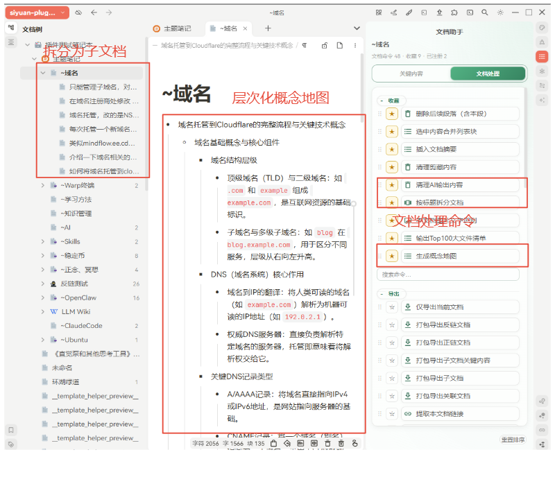

# 文档助手 + AI —— v1.6.0 新功能预览

## 文档助手 v1.6.0 新功能预览

### 1. 生成概念地图 —— 一种知识整理的方法

- AI 问答 - 导入到思源笔记
- 文档助手：清理AI输出内容 - 按标题拆分文档 - 生成概念地图

<video controls="controls" src="assets/一种知识整理的方法-20260606103128-xtz07l9.mp4"></video>

### 2. 插入文档摘要

> 读取当前文档正文生成 AI 摘要，并插入到正文开头；

### 3. 标记口水内容（beta）

> 用 AI 识别正文中的口水段落，并为整段加删除线；

### 4. 标记关键内容（beta）

> 用 AI 识别正文中的关键句并在原段落内局部加粗；

### 5. 本文档图片文字识别

> 将本文档所有图片逐个发送给 AI 多模态大模型，识别成文字后以引用格式插入到对应图片下方。

<video controls="controls" src="assets/OCR-20260606150645-l1t9lag.mp4"></video>

### 6. 本文档逐段翻译

> 将当前文档中包含英文字母的段落逐段发送给 AI 大模型翻译为中文，并把译文插入到原段落下方。

### 7. 清理AI输出内容（beta）

> 清理常见 AI 报告残留，如脚注上标、\^\^ 标记、隐藏引用 span、引用标记和"互联网"来源链接；目前主要适配 Deep Research 类输出。

### 8. 添加相关链接和标签

> 对当前文档生成 AI 关联文档建议，确认后在文首插入相关文档链接并给当前文档写入建议标签；

<video controls="controls" src="assets/打标-20260606161305-o7kr367.mp4"></video>

### 9. 一键生成画布

> 基于文档关键内容和层次结构，一键自动生成画布；

<video controls="controls" src="assets/一键生成画布-20260606124710-uv5hqyd.mp4"></video>

### 10. 生成 LLM Wiki 文档（beta）

> 基于当前文档及关联文档生成 LLM-Wiki 页面；

<video controls="controls" src="assets/wiki-20260606175320-5tdhpya.mp4"></video>

## 附录

- [思源笔记文档助手，协助你整理笔记的好帮手 - 链滴](https://ld246.com/article/1772292058880) *
- [将“无压”进行到底——如何借助“思源文档助手”整理、维护主题笔记 - 链滴](https://ld246.com/article/1773147678819) *
- [是谁占了我这么大空间？ - 链滴](https://ld246.com/article/1777612530508) *
- [Daily Notes 工作流在思源笔记的应用 - 链滴](https://ld246.com/article/1754488585238) *
- [为了让思源笔记用起来更顺手，我打算开发 10 个插件，目前进度…… - 链滴](https://ld246.com/article/1775894033664) *

‍
