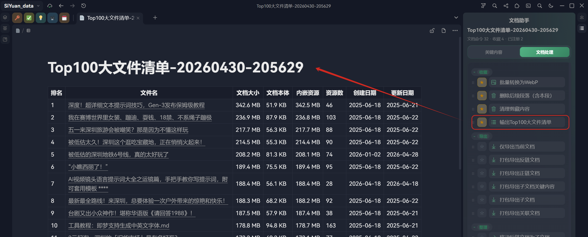

# 是谁占了我这么大空间？

思源笔记插件开发实践   *

## 咋回事？思源笔记数据居然超过90G了？

我的思源笔记数据已经超过 90G 了，还在持续增长中……主要是我的“松鼠症”作祟，剪藏了大量公众号文章，当时觉得“以后可能有点用”，但实际上大多都束之高阁，剪藏后就再也不会打开了。但我也有点困惑，印象里并没有在笔记中插入视频等大文件，光是文字和图片怎么会占到 90G 空间的，是谁占了我这么大空间？

趁五一假期有空，我决定好好清理一番，特别是那些占据大量存储空间的老旧文档。但是从哪里下手呢？思源笔记并没有提供笔记大小统计的便捷功能，文档树按“文档大小排序”实际只统计了笔记中的文字，但最占空间的显然不是文字，而是笔记内嵌的资源文件。

于是我在 **“思源文档助手”** 插件中增加了一个 **“输出 Top100 大文件清单”** 的命令，最终发现我的大文件主要是来自一个深圳本地公众号的剪藏文章——我剪藏它们是打算用作周末带娃去处的游玩指南——每篇文章都内嵌了大量未经压缩的照片，难怪占了这么大空间了。

找到罪魁祸首就好办了，那些过期或参考价值不大的文档直接删除，还有些则借助“思源图片快剪”插件对其中的图片进行快速压缩，压缩比例可以高达 90%。

嗯，你别说，偶尔搞一次笔记大扫除，颇有成就感，还挺解压的……

‍

## 附录

[思源笔记文档助手，协助你整理笔记的好帮手 - 链滴](https://ld246.com/article/1772292058880)

[一个小插件，缓解你的笔记存储焦虑 - 链滴](https://ld246.com/article/1774704617700)
