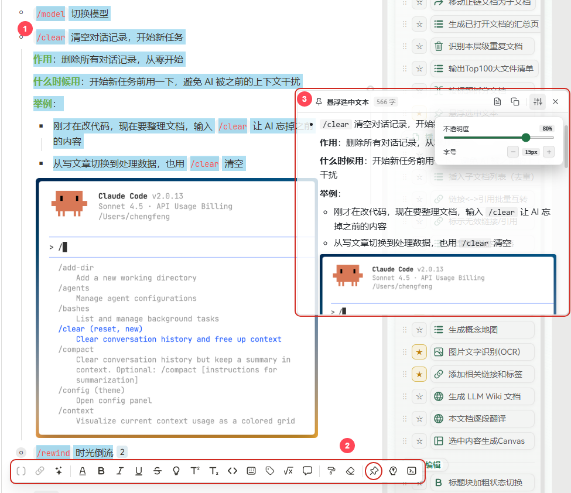
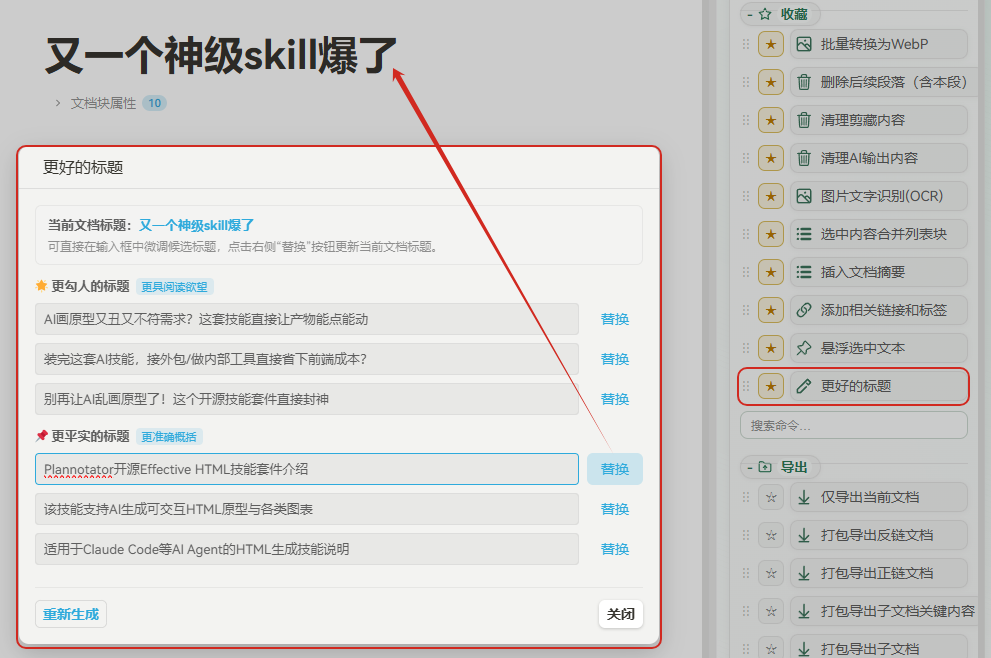
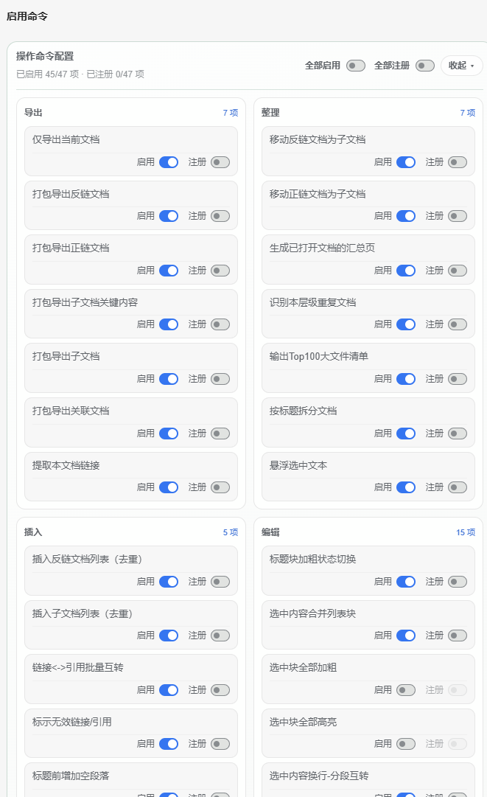

# 置顶悬浮窗、AI生成标题——思源文档助手v1.6.5新功能预览

> 让关键信息一目了然，让笔记整理一键完成。

## 思源文档助手v1.6.5新功能预览

### 1. 置顶悬浮窗（悬浮选中文本）：让关键参考资料始终置顶显示

在日常数字办公与知识管理中，我们常常陷入一些“微小却极其消耗精力”的体验缝隙里。比如说，你一定遇到过这样的场景：一边在思源笔记里查阅刚整理好的 API 规范、参考资料、操作要点，一边要在 IDE、Word 甚至是在思源笔记的另一篇笔记中敲下代码或文字。每一次鼠标点击第三方应用，思源窗口便悄然退入系统后台，逼得你不断在 `Alt + Tab` 中反复横跳，刚刚建立起来的专注被切得支离破碎。

为此，“思源文档助手”新增了“置顶悬浮窗（悬浮选中文本）”功能：

**选中文本 > 浮动工具栏选择“悬浮” >**  **随意拖动悬浮窗，在不同应用界面始终置顶显示**

#### 场景 A：跨软件对比写作与代码编写

- **情境**：程序员在思源笔记中整理了 API 设计规范或算法伪代码，需要在 IDE（VSCode/IntelliJ）中实现；或者学者在思源中整理了英文参考文献，需要在 Word 中撰写中文论文。
- **操作**：在思源笔记中选中关键段落，右键或点击工具栏“📌 悬浮选中文本”。
- **体验**：选中的内容瞬间生成一个跨应用的窗口，始终保持在屏幕最前。用户可以直接在 IDE 或 Word 中畅快打字，无需再来回切换应用。

#### 场景 B：网络剪藏与多源资料对照翻译

- **情境**：翻译人员或阅读者需要将外文笔记翻译为中文，或者对比两篇不同来源的剪藏文章。
- **操作**：将原文段落悬浮置顶，并调至半透明磨砂模式，叠放在目标编辑区旁边。
- **体验**：实现实时逐句对照，眼不离屏，翻译与对比效率大幅提升。

#### 场景 C：桌面轻量级透明便签与临时记忆

- **情境**：在日常工作中，有临时需要盯紧的 Task 列表、会议要点或代码指令。
- **操作**：选中文本后置顶悬浮，快捷调节字号，并将透明度调整至约 30%。
- **体验**：便签如水印般自然融入桌面背景，既不遮挡下方浏览网页的内容，又随时可查。

‍

### 2. AI 生成更好的标题

有时候，你满怀热忱地剪藏保存了几十篇优质文章，准备建立自己的知识库。然而过了一段时间发现很多文章全都是《震惊！全网都在传的秘密终于揭开了》、《看完大家都沉默了》这样的标题党。缺少有效信息的标题不仅污染了你的知识库目录，更让后续的回顾与搜索变成了一场噩梦。

也有时候，你煞费苦心撰写了文章发布到公众号、知乎、小红书或博客时，苦于写不出具备强好奇心与传播力的“钩子”标题，花了很多精力输出的好文章却没有什么阅读量。或者平常写作或记录会议纪要时，随手填写“新建文档”、“未命名”、“关于项目的思考”，随着笔记增多，这些文章都难以一眼识别要旨。

也许，AI 可以帮你生成一些“更好的标题”，提供一些创意和思路，减少你的工作量。但，最终选择权始终在你。

#### 场景 A：网络剪藏文章治理与知识库规范化重构

- **原标题**：《震惊！全网都在传的这个秘密，终于被揭开了！》
- **痛点**：隔天在思源笔记检索时，输入关键词搜索不到，全局浏览时也无法判断内容。
- **AI 重构后**：选择【更平实】候选方案 —— 《2026 年前端构建工具 Vite 6 核心架构演进与性能优化指南》。
- **价值**：将无价值的垃圾标题一键重构为**高信息密度、利于检索、结构清晰**的规范知识库文档标题。

#### 场景 B：自媒体与公开发布打磨“爆款标题”

- **原标题**：《我使用 TypeScript 替换 JavaScript 的一些心得》
- **需求**：希望发布到技术社区吸引更多读者阅读讨论。
- **AI 重构后**：选择【更勾人】候选方案 —— 《重构 5 万行代码后，我为什么劝你彻底放弃原生 JS？》。
- **价值**：利用内置的启发式 Prompt 算法，自动生成自带悬念与好奇心钩子的候选标题，大幅提高文章点击率与传播力。

#### 场景 C：长文提炼与会议纪要归档

- **情境**：在思源笔记中记录了一份长达数千字的讨论记录或读书笔记，一时难以概括。
- **操作**：使用“AI 生成更好的标题”，AI 自动阅读正文，给出 3 个精准提炼的核心摘要标题。
- **价值**：一秒提取长文主旨，省去手动重新阅读总结的繁琐过程。

‍

### 3. 其他新特性

- **块范围选择快捷操作**：新增“从文首选择到当前块”与“从当前块选择到文末”两项块选择动作；

- **图片文字识别(OCR)长图切片**：对高度超过 3000px 的超长图自动分段切片识别并在文本间插入分割线；支持优先识别选中的图片块；
- **脉络镜插件兼容**：适配脉络镜插件（Network Lens）顶层标签建格式及 AI 文档索引；
- **命令启用开关**：设置页支持“文档菜单”和“快捷面板”双维度独立启用/禁用命令，并提供开箱默认配置；“选中块全部加粗”、“选中块全部高亮”命令默认不启用；

  

## 附录

- [思源笔记文档助手，协助你整理笔记的好帮手 - 链滴](https://ld246.com/article/1772292058880) *

  - [将“无压”进行到底——如何借助“思源文档助手”整理、维护主题笔记 - 链滴](https://ld246.com/article/1773147678819) *
  - [Daily Notes 工作流在思源笔记的应用 - 链滴](https://ld246.com/article/1754488585238) *
  - [是谁占了我这么大空间？ - 链滴](https://ld246.com/article/1777612530508) *
- [文档助手 + AI —— v1.6.0 新功能预览 - 链滴](https://ld246.com/article/1780721267540)
- [为了让思源笔记用起来更顺手，我打算开发 10 个插件，目前进度…… - 链滴](https://ld246.com/article/1775894033664) *

‍
